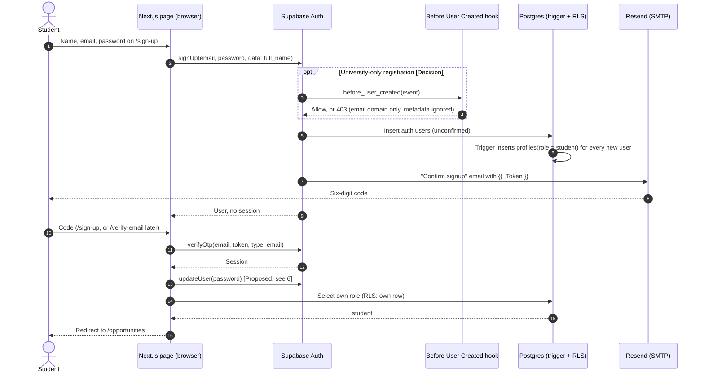

# Account sign-up and roles: architecture review and implementation plan

**Date:** 2026-11-08 (revision 3) · **Status:** implemented and verified locally; hosted unverified ·
**Scope:** how students, professors, and admins get accounts and roles.
Students register themselves with email and password, verify a six-digit code,
and reach `/opportunities` without waiting for anyone. Professors request
access and are approved by the team. Admins are provisioned only by trusted
team members.

Implementation update: `20261108120000_account_signup_hardening.sql` and the
password-setup/recovery/invitation UI are now implemented on
`codex/student-signup-auth`. The local code flow adds an explicit **Set password
and continue** step with the original signup password prefilled only in memory.
The domain restriction and professor request mailbox remain decisions. Sections
below preserve the architecture rationale and original plan; use the README for
the current setup/rollout checklist. Hosted signup remains closed pending staging.

Labels used throughout:

- **[Existing]** verified in the repository or by a read-only check on 2026-11-08.
- **[Proposed]** a change this plan recommends.
- **[Unverified]** a hosted setting or Supabase behavior that could not be
  inspected without dashboard access or a test. Confirm it before launch.
- **[Decision]** a product decision that is still open.

**Revision 3 changes:**

- Students stay fully self-service. The database gives **every** new Auth
  account a `student` profile, with no team step and no dependency on user
  metadata.
- "No self-created profiles" now means only that clients cannot insert
  profile rows directly.
- Professor approval is the admin's role change, enforced in the database. The
  `private.account_approvals` table from revision 2 is withdrawn (section 5.4
  explains why it is unnecessary).
- University-only registration remains a separate, open decision, and the
  rollback order from revision 2 is kept.

---

## 1. Recommendation in brief

Use Supabase Auth for every account. Keep roles in `public.profiles`, written
only by the database.

| Account | How it is created | How it gets its role | Team involvement |
|---|---|---|---|
| **Student** | Public sign-up at `/sign-up` (email, password, six-digit code). | Database trigger inserts `role = 'student'` in the same transaction that creates the Auth user. | None. |
| **Professor** | Faculty request access; the team invites them (interim: creates them). | An admin activates **Professor** at `/admin`. The database allows it only for an admin caller and only for an account whose email is confirmed or that the team invited. | Verify the person, invite, approve. |
| **Admin** | Team creates the account in the Supabase dashboard. | SQL Editor only. No app path can grant `admin`. | Trusted team member with dashboard access. |

Before opening registration:

1. **Provision a student profile for every new Auth user.** The trigger stops
   reading `self_signup`. Whatever a client sends, the result is one
   `student` profile.
2. **Block direct client inserts into `profiles`.** Drop the self-insert
   policy; the trigger, `admin_set_user_role`, and the SQL Editor remain.
3. **Enforce professor approval in `admin_set_user_role`** and log every role
   change. No approval table is needed.
4. **Make the production gate a deliberate switch** (`NEXT_PUBLIC_ENABLE_SELF_SIGNUP=true`).
5. **Use code-only emails** (Microsoft Safe Links can use up links), finish
   hosted email and URL settings, add DMARC, and size launch limits.
6. **[Decision]** Only if registration is university-only: a *Before User
   Created* hook checks the email domain.

---

## 2. What was verified

| Area | Finding | Label |
|---|---|---|
| Frontend auth | One browser supabase-js client (`frontend/lib/supabase/client.ts`, anon key, session persisted by supabase-js). No `proxy.ts`, no `@supabase/ssr`, no server code that reads user data in production. | Existing |
| Sign-up UI | `/sign-up` → `StudentSignup.tsx`: validates fields, calls `signUp` with `data: { self_signup: true, full_name }`, then a code screen calling `verifyOtp({ email, token, type: "email" })`. `/verify-email` recovers an interrupted verification. The sign-up page tells professors to sign in with details the team sent. | Existing |
| Production gate | `frontend/lib/release.ts`: `publicSignupEnabled()` returns `false` whenever `NODE_ENV === "production"`. Live `/sign-up` → 307 `/sign-in`. | Existing |
| Profile provisioning | Migration `20261004120000`: `after insert on auth.users` trigger creates `profiles(role = 'student')` **only when** `raw_user_meta_data.self_signup = 'true'`. Role hard-coded; name sanitized and capped. Accounts without the marker get no profile and show as "Needs a role" on `/admin`. | Existing |
| Client profile writes | Insert policy `Users can insert their own student profile` (own row, `role = 'student'`). Update policy on own row; trigger `prevent_profile_role_change` rejects any role change by an authenticated user except an admin changing someone else's. | Existing |
| Professor activation | `admin_set_user_role(target, role)`: security definer, caller must be admin, cannot target self, can assign only `student` or `professor`, cannot change an admin. It accepts **any** account, including unconfirmed ones, and records nothing about who approved. | Existing (gap) |
| Admin provisioning | `README`/`Docs.md` reference: dashboard **Add user** (auto-confirm), then SQL Editor `insert … on conflict (id) do update set role = 'admin'`. | Existing |
| Team provisioning | Dashboard **Add user** with a password and auto-confirm, then `/admin` **Activate**, or a SQL insert. No invitation or set-password page exists in the app. | Existing |
| Listing reads | Any signed-in account, **with or without a profile**, can read published listings. Applying requires a student profile (`is_student`). | Existing (gap) |
| Hosted Auth (public settings) | `disable_signup: false`, `mailer_autoconfirm: false`. The Auth API already accepts registrations from any address. | Existing (gap) |
| Hosted migrations | All 10 applied through `20261023120000`; nothing pending. | Existing |
| Live site | `https://www.ntcresearchnetwork.org` (apex 308 → `www`). | Existing |
| DNS (Vercel DNS) | Resend DKIM and `send` records present. **No `_dmarc` record.** | Existing / Unverified |
| SMTP, templates, OTP settings, URL configuration, rate limits, hooks, CAPTCHA, Resend plan, Vercel variables | Not readable without dashboard access. **Email delivery through Resend has not been proven.** | Unverified |

---

## 3. Responsibilities

| Component | Owns | Must not own |
|---|---|---|
| **Next.js (browser pages)** | Forms, inline validation, clear errors, calling Auth methods, reading the user's own role to choose a workspace, the build-time release gate, the professor request link. | Authorization, role assignment, any secret. |
| **Supabase Auth** | Password hashing, user records, email confirmation and codes, invitations, sessions, rate limits, the optional *Before User Created* hook. | App roles. |
| **Resend** | Delivering Auth emails over SMTP from the verified domain. | Choosing recipients. |
| **Postgres** | Student profile provisioning (trigger), role immutability (trigger), professor approval rule and audit log (`admin_set_user_role`), all read/write authorization (RLS), the optional registration policy. | Trusting anything a client sends, including user metadata. |
| **Team** | Verifying that a professor request comes from real faculty, inviting them, activating the role, appointing admins. | Approving students (not required). |

---

## 4. Flows

### 4.1 Student (self-service)



No team step. A student's access is the same whether they used the website or
called the Auth API directly, with or without any metadata.

### 4.2 Professor (request, invitation, approval) [Proposed]

1. **Request.** `/sign-up` and `/sign-in` show "Faculty member? Request a
   professor account", a `mailto:` link to a team mailbox **[Decision: which
   address]**. No form, table, or new data is stored.
2. **Verify.** A team member confirms that the person is faculty and that the
   email is their university address (faculty directory, department).
3. **Invite.** Dashboard → Authentication → Users → **Invite user**. Auth
   creates the user and the trigger gives it a `student` profile.
4. **Approve.** At `/admin`, the admin chooses **Professor → Activate** right
   away. `admin_set_user_role` allows it because the account was invited by
   the team (section 5.4).
5. **Accept.** The professor enters the emailed code at a new
   `/accept-invite` page (`verifyOtp` type `invite`), sets a password
   (`updateUser`), and lands on `/professor/opportunities`.

**Interim, until `/accept-invite` exists [Existing]:** step 3 uses **Add
user** with auto-confirm, and the team gives the professor their initial
password out of band. The account is confirmed, so step 4 is allowed. This is
weaker (the team knows the first password and there is no reset page), so the
invite page is the recommended follow-up.

If a professor already has a **confirmed** student account with their
university email, the admin may activate that account instead (step 4). If an
**unconfirmed** account exists for the email (someone registered it but never
verified it), delete it and invite fresh.

### 4.3 Admin (trusted provisioning) [Existing]

Create the user with dashboard **Add user** (auto-confirm). The trigger gives
it a `student` profile; then, in the SQL Editor:

```sql
update public.profiles set role = 'admin' where id = '<user-uid>';
```

The SQL Editor runs as `postgres`, so `prevent_profile_role_change` allows it.
The Docs.md provisioning SQL for students and professors must switch from a
plain `insert` to `insert … on conflict (id) do update set role = …`, because
the profile now already exists.

### 4.4 Sign-in [Existing]

`signInWithPassword`, then the role lookup decides the workspace. Unconfirmed
users get `email_not_confirmed` and are offered code entry and resend.

---

## 5. Trust model and authorization

### 5.1 What can and cannot be trusted

Anyone can call Supabase Auth with the public anon key, skipping the website.
**Attacker-controlled:** user metadata (`self_signup`, `full_name`, `role`,
anything else), which page or client made the request, and the email address
until the account is confirmed.

**Trusted:** the caller's identity inside RLS and security-definer functions
(`auth.uid()`, `is_admin`); Auth columns that only Auth or the service role
set (`email_confirmed_at`, `invited_at`); and the SQL Editor or service-role
access held by the team.

Because the trigger now ignores metadata, `self_signup` stops mattering. The
client can stop sending it.

### 5.2 Why public sign-up can never yield professor or admin

| Path an attacker might try | Blocked by |
|---|---|
| `signUp` with `data: { role: "professor" }` or `"admin"` | Trigger hard-codes `student` and reads no role [Existing]. |
| Insert their own `profiles` row with another role | No client insert policy after G2 [Proposed]. Today's policy already limits it to `student` [Existing]. |
| Update their own `role` | `prevent_profile_role_change` raises 42501 [Existing]. |
| Call `admin_set_user_role` or other admin RPCs | `is_admin(auth.uid())` check raises 42501 [Existing]. |
| Get an admin to promote them by mistake | Promotion needs a confirmed or team-invited account, and the team verifies faculty identity first (5.4). Every change is logged [Proposed]. |
| Become admin through the app | `admin_set_user_role` rejects `admin`; admin roles change only in SQL [Existing]. |

### 5.3 Gaps and fixes [Proposed]

| Gap | Risk | Fix |
|---|---|---|
| G1. Published listings readable by accounts with no profile. | Accounts that existed before this change without a profile can browse listings. | `using (status = 'published' and public.has_profile((select auth.uid())))`, with a security-definer `has_profile(uuid)` helper like `is_student`. After the trigger change, only those older accounts lack a profile. |
| G2. Clients may insert their own `student` profile. | A second, unaudited provisioning path. No app code uses it. | Drop `Users can insert their own student profile`. Profiles come only from the trigger, `admin_set_user_role`, or SQL. |
| G3. Profile provisioning depends on `self_signup`. | Metadata decides who gets a profile; direct API users without it end up in "Needs a role". | Replace the trigger function (`create or replace`) so every new `auth.users` row gets a `student` profile, `on conflict (id) do nothing`. The name is still sanitized. |
| G4. An admin can promote any account, unconfirmed included, with no record. | An admin could activate an account whose inbox ownership is unproven, and nobody could later tell who approved it. | Approval rule and audit log in `admin_set_user_role` (5.4). |
| G5. **[Decision]** Any email domain can register. | Only matters if the product is university-only. | *Before User Created* hook (5.5). |

G1–G4 apply under either registration decision.

### 5.4 Enforcing professor approval: no approval table needed

**The approval is the admin's role change.** The `professor` role can be
written only by `admin_set_user_role`, which only admins can run. That is the
enforcement point. A separate approval table would duplicate it.

Revision 2 used `private.account_approvals` so an admin could not promote a
stranger's account that looked like a team-created one. Revision 3 removes
that ambiguity more simply:

- every account is now a student, so there is no "Needs a role" queue to mix
  up;
- the admin picks the account by email after verifying that the email belongs
  to faculty, which is the same check an approvals list would record;
- the database refuses promotion unless the inbox is proven or the team
  created the account.

Changes to `admin_set_user_role` when `new_role = 'professor'`:

```sql
-- Sketch, inside admin_set_user_role after the existing checks.
if new_role = 'professor' and not exists (
  select 1 from auth.users u
  where u.id = target_user_id
    and (u.email_confirmed_at is not null or u.invited_at is not null)
) then
  raise exception using errcode = '42501',
    message = 'confirm the email or invite the account before making it a professor';
end if;

-- After the profile upsert, for every role change:
insert into private.role_changes (user_id, old_role, new_role, changed_by)
values (target_user_id, existing_role, new_role, auth.uid());
```

- `email_confirmed_at` proves the account holder controls the inbox, so the
  person promoted is the person the team verified.
- `invited_at` is set only by the invite endpoint, which needs the service
  role, so the team typed the address. It lets the admin activate the role
  before the professor accepts. **[Unverified]** that hosted Auth sets it as
  expected; the integration test checks it.
- `private.role_changes` is an append-only log, in a schema the Data API does
  not expose, written only by this function. It is an audit record, not an
  approval gate. It lives outside `profiles` because users can update their
  own profile row and could overwrite audit columns there.

**A separate table is warranted only if** the team later wants (a) an
in-app professor request form with a review queue (`professor_requests`:
requester, department, note, status), or (b) exact-address exceptions under a
university-only hook (5.5). Neither should grant a role automatically.

### 5.5 Registration policy hook [Decision: only if university-only]

The hook allows account creation **only if** the email's domain is in
`private.allowed_signup_domains` **or** the full address is in
`private.allowed_signup_emails` (exceptions for non-university faculty or
admins). It never reads metadata. Matching is exact after lower-casing and
trimming.

```sql
create function public.hook_before_user_created(event jsonb)
returns jsonb language plpgsql stable set search_path = '' as $$
declare
  -- Prefixed names avoid clashing with the tables' columns.
  v_email  text := lower(btrim(event -> 'user' ->> 'email'));
  v_domain text := split_part(v_email, '@', 2);
begin
  if exists (select 1 from private.allowed_signup_domains d where d.domain = v_domain)
     or exists (select 1 from private.allowed_signup_emails e where e.email = v_email) then
    return '{}'::jsonb;
  end if;
  return jsonb_build_object('error', jsonb_build_object(
    'http_code', 403,
    'message', 'This email address cannot be used to create an account.'));
end; $$;

grant usage on schema private to supabase_auth_admin;
grant select on private.allowed_signup_domains, private.allowed_signup_emails to supabase_auth_admin;
grant execute on function public.hook_before_user_created to supabase_auth_admin;
revoke execute on function public.hook_before_user_created from authenticated, anon, public;
```

The hook only decides **whether** an account may exist. Roles are unaffected:
an allowed address still gets `student`. Whether Supabase runs the hook for
dashboard invites and **Add user** is **[Unverified]**. If it does, team
accounts outside the allowed domains need an exception row first.

### 5.6 How each request is handled

| Request | Metadata | Hook (if enabled) | Profile | Access after verification |
|---|---|---|---|---|
| Student via website | `full_name` | Domain check | `student` | Student. |
| Direct API, honest or forged metadata (`role: "admin"`) | anything | Domain check | `student` | Student. Same as the website. |
| Direct API, no metadata | none | Domain check | `student` | Student. |
| Team invite (professor) | none | Domain check, or exception row | `student`, then `professor` by admin | Professor after accepting. |
| Team **Add user** (interim professor, admin) | none | Domain check, or exception row | `student`, then team sets role | As set by the team. |
| Promotion of an unconfirmed, non-invited account | — | — | unchanged | **Rejected** by `admin_set_user_role`. |

---

## 6. Edge cases

| Situation | Current behavior [Existing] | Proposed |
|---|---|---|
| Wrong or expired code | "That code is invalid or expired…", resend control. | Add: "If you already verified this email, sign in instead." |
| Resend | 60 s cooldown; messages do not reveal whether an account exists. | Fix the countdown wording: "Send another **code** in Ns". |
| Duplicate sign-up, confirmed address | Code screen without claiming the account is new; locally `user_already_exists` → "Sign in instead". | Keep. Confirm hosted behavior in staging. |
| **Address registered by someone else first** | **Confirmed locally on 2026-11-08 (GoTrue v2.196.0):** if a stranger signs up `victim@…` with password A, and the real owner later signs up with password B, Auth keeps A. The owner's code verifies the account, then **A signs in and B fails**. The profile keeps the stranger's name. | **Required, in three parts (sections 6.1–6.4):** (1) a database trigger discards the password stored before a self sign-up is first confirmed; (2) after `verifyOtp`, `/sign-up` sets the password just entered and the profile name; (3) a new `/reset-password` page lets an owner whose setup was interrupted set a password. The password update alone is **not** enough: an attacker who signs in during the gap keeps database access until the token expires (6.2). |
| Missing profile | Sign-in and verify sign the user out and say "contact the team". | After G3, only accounts that existed before this change can lack a profile. Admins activate them at `/admin`. |
| Professor accepts invite before activation | n/a | They would see the student workspace. Avoided by activating right after inviting (4.2). |
| Professor already has a student account | n/a | Activate it if confirmed; their applications stay attached to the account. Otherwise invite fresh. |
| Delivery failure | `signUp` error → "Your account was not created…". Exact hosted error and rollback **[Unverified]**. | Capture in staging; map to "We could not send your code. Try again in a few minutes." |
| Code in junk/quarantine | "Check your spam folder". | DMARC, verified sender, plain code-only template; test a real university mailbox. |
| Rate limited | "Too many attempts. Wait a few minutes." | Raise limits for launch (section 8). |
| Rejected by the hook [Decision] | n/a | Show the message on the email field with the allowed domain. |

### 6.1 Pre-registration test results (local, 2026-11-08)

Run against local Supabase (CLI 2.104.0, GoTrue v2.196.0), with Mailpit as
the inbox and throwaway `@example.test` addresses. Local sign-up and the
email limit were raised only for the test, and `config.toml` was restored
byte-for-byte afterwards. The test users were deleted.

| Step | Without the fix | With `updateUser({ password: B })` after verify |
|---|---|---|
| 1. Sign up with password A | 200, no session, 1 email | Same |
| 2. Sign up again with password B | 200, same user id, 2nd email | Same |
| Before verifying | A: `email_not_confirmed`; B: `invalid_credentials` | Same |
| 3. Verify the newest code | 200, session | 200, session; password update 200 |
| 4. Sign in with A | **200 (stranger gets in)** | 400 `invalid_credentials` |
| 4. Sign in with B | 400 (owner locked out of their password) | **200** |
| Name on the profile | Stranger's ("First Registrant") | Stranger's, so the fix must also set the name |

"A fails, B works" shows only that **new** sign-ins are safe. It does not
show that a session the stranger already holds has lost access. Sections 6.2
and 6.3 test that.

**Status of everything in 6.1–6.4: verified locally only** (GoTrue v2.196.0,
PostgREST v14.5). Hosted behavior is **[Unverified]** until the staging run
in Step 3.

### 6.2 Login during the gap (local, 2026-11-08)

Stranger signs in with A after the owner's code is verified but before the
owner's password update. Local `jwt_expiry` was set to 60 s for this run so
expiry could be observed (hosted default: 3600 s).

| Stranger's session after the owner sets B | Password update only | With the trigger (6.4) |
|---|---|---|
| Sign in with A during the gap | 200, session issued | **400 `invalid_credentials`**, no session |
| Refresh the stranger's token | 400 `refresh_token_not_found` | n/a |
| Auth `/user` with the stranger's token | 403 `session_not_found` | n/a |
| Read own profile and published listings (RLS) | **200, rows returned** | n/a |
| Update the profile name | **200, row changed** | n/a |
| Apply to a listing as the account | **201, application created** | n/a |
| Same requests 3 s after the token's `exp` | **Still 200** (PostgREST allows clock skew) | n/a |
| Same requests 35 s after `exp` | 401 `PGRST303` | n/a |

**Result: fails without the trigger.** The password update revokes refresh
tokens, but the issued access token keeps student-level **read and write**
access for its remaining lifetime plus about 30 s. On hosted defaults that is
up to about an hour. In that time the stranger could submit applications
that show the owner's email to professors. With the trigger, no session can
be issued with A, so there is nothing to revoke.

### 6.3 Interrupted setup (local, 2026-11-08)

The owner verifies, then the password update fails or the browser closes.

| | Password update only | With the trigger (6.4) |
|---|---|---|
| A signs in after verification | **200, and again later: A stays usable until the owner acts** | 400 |
| B signs in | 400 | 400 (no password stored yet) |
| Owner resumes with the saved session (refresh token, after its access token expired) | 200; setting B succeeds; stranger's refresh revoked; A then fails | 200; setting B succeeds; B then works |
| Owner lost the session: password recovery email → verify → set C | Works; A and B fail, C works; stranger's refresh revoked | Works; A and B fail, C works |

**Result: owner can recover either way, but only the trigger stops A from
staying usable indefinitely.** Recovery needs a `/reset-password` page,
which the app does not have yet.

### 6.4 Candidate fix: discard the unproven password at first confirmation

A `before update` trigger on `auth.users` (prototyped in the local database
only, then removed):

```sql
if old.email_confirmed_at is null
   and new.email_confirmed_at is not null
   and (coalesce(old.confirmation_token, '') <> '' or old.confirmation_sent_at is not null) then
  new.encrypted_password := '';
end if;
```

A password stored before anyone proved the inbox is discarded in the same
transaction that confirms it. The verified owner then sets one from the
session that verification returns.

The pending-confirmation condition is needed. The first version, without it,
also cleared passwords set by the team's **Add user** with auto-confirm:
Auth confirms those accounts in a separate update after inserting them, and
they then could not sign in. Logging the pre-update rows showed that a self
sign-up has a pending confirmation token and a sent timestamp. Add user and
invites have neither (invites carry a random password Auth sets itself).

| Control (with the narrowed trigger) | Result |
|---|---|
| Normal sign-up: verify, then the page sets B | Before the page update B fails (expected); after it, B works. |
| Normal sign-up, page sets the same password without the trigger | `422 same_password`. The page must treat this as success. |
| Team **Add user** with auto-confirm | Sign-in works. |
| Team invite: accept, then set a password | Sign-in works. |

Trade-offs and risks:

- A student whose browser closes after verifying has **no password** and
  must use "Forgot password". `/sign-in` should point them there.
- The trigger relies on how GoTrue fills `confirmation_token` and
  `confirmation_sent_at`, and on it confirming accounts with an `UPDATE`.
  These are internals that could change. The integration tests must run on
  every Supabase CLI or hosted upgrade, and in staging.
- Writing an `auth.users` column from a trigger is less conventional than
  the existing `after insert` trigger. If hosted Supabase rejects or
  overrides it, keep signup closed until an alternative passes both security
  cases. A password update plus shorter JWT expiry does not fix interrupted
  setup: the attacker could keep obtaining new sessions with the retained password.
- The profile still holds the first registrant's name until the page sets
  it from the form.

The hosted setting *Secure password change* (local: off) could require
reauthentication for `updateUser`. A session that was just created should
pass, but staging must confirm it.

---

## 7. Hosted settings, DNS, environment, and the gate

**Supabase (Dashboard → Authentication)**, all **[Unverified]**:

| Setting | Value |
|---|---|
| Emails → SMTP | Host `smtp.resend.com`, port `465`, username `resend`, password = a sending-only Resend API key. Sender e.g. `noreply@ntcresearchnetwork.org`, name `ResearchBridge`. |
| Email Templates → Confirm signup | Code only: `{{ .Token }}`, **no `{{ .ConfirmationURL }}`** (`backend/supabase/templates/confirm_signup.html`). |
| Email Templates → Invite user | Code only, pointing to `/accept-invite` (when that page ships). |
| Sign In / Providers → Email | Confirm email on, minimum password length 8, OTP length 6, OTP expiry 3600 s. |
| URL Configuration | Site URL `https://www.ntcresearchnetwork.org`; redirect URLs `https://www.ntcresearchnetwork.org/auth/callback`, `http://localhost:3000/auth/callback`. |
| Allow new users to sign up | **Off until launch** (currently on). Turn on last. Team invites and **Add user** are expected to keep working while it is off **[Unverified]**. |
| Hooks → Before User Created | **[Decision]** Only if university-only; enabled **before** sign-up is turned on. |
| Rate limits | Section 8. |
| CAPTCHA | Off at launch. Turning it on also gates password sign-in. |

**DNS:** keep the Resend DKIM and `send` records as shown in Resend's
dashboard. **Add DMARC:** `_dmarc` TXT
`v=DMARC1; p=none; rua=mailto:<team mailbox>`; tighten later.

**Vercel (Production):** `NEXT_PUBLIC_SUPABASE_URL` and
`NEXT_PUBLIC_SUPABASE_ANON_KEY` (public by design);
`NEXT_PUBLIC_ENABLE_SELF_SIGNUP` absent until launch, then `true` (inlined at
build time, so changing it needs a redeploy). The Resend API key lives only in
the Supabase SMTP password field.

**Gate change [Proposed]** in `frontend/lib/release.ts`:

```ts
export function publicSignupEnabled(flag = process.env.NEXT_PUBLIC_ENABLE_SELF_SIGNUP): boolean {
  return flag === "true";
}
```

The gate is a launch switch, not a security control.

---

## 8. Sending limits and abuse controls

| Limit | Default | Launch recommendation |
|---|---|---|
| Supabase emails per hour (custom SMTP) | 30, project-wide | Raise to cover the peak hour, e.g. 150–300. |
| Per-user email interval | 60 s | Keep. |
| Sign-ups + sign-ins per IP | 30 per 5 min | Campus Wi-Fi shares IPs. Raise to 100–150 for launch, then lower. |
| `/verify` per IP | 30 per 5 min | Same. |
| Resend free plan | 100/day, 3,000/month | Too small for launch day. Use a paid plan for launch week or stagger. |

Abuse controls, in order of value: role provisioning that ignores the client
(G2, G3, 5.2); email confirmation; the domain hook if chosen; Supabase rate
limits; Resend suppression and log monitoring; CAPTCHA only if abuse appears.

---

## 9. Alternatives

| Option | Verdict |
|---|---|
| **A. Supabase Auth for everyone; trigger gives every user `student`; admin activation is the professor approval** | **Recommended.** Smallest change, no metadata trust, no new authorization tables. |
| B. Keep the `self_signup` marker to decide who gets a profile | Rejected. Metadata is client-controlled and creates a "Needs a role" queue that mixes team accounts with direct-API ones. |
| C. Approval table (`account_approvals`) checked before professor activation | Withdrawn. It repeats the admin's own check; confirmed-or-invited plus the audit log covers the same risk. |
| D. Auto-grant professor to emails on a pre-approved list | Rejected. Turns a list entry into an automatic privilege grant at sign-up; a typo grants access. |
| E. Professors use public sign-up, then request promotion | Allowed as a fallback (activate a confirmed account), but not the primary flow: the request asked for a separate professor path. |
| F. Server-side auth (`@supabase/ssr`, cookies, `proxy.ts`) | Later. RLS already guards every query; the public Auth API remains reachable either way. |
| G. Tulane SSO | Revisit after the pilot. |

---

## 10. Implementation plan

### Step 0 — Unblock [Done in revision 2]

The four byte-identical ` 2` duplicates were removed; nothing is pending in
`supabase migration list --linked`. Still to do: commit or park the
`codex/professor-opportunity-editing` work so the sign-up PR starts from a
clean `main`.

### Step 1 — Database and gate PR (safe while sign-up stays closed)

| File | Change |
|---|---|
| `backend/supabase/migrations/<ts>_account_roles_hardening.sql` (new) | `create or replace` the trigger function to provision `student` for every user (G3); `has_profile(uuid)` and the published-read policy (G1); drop the self-insert policy (G2); `private` schema with no client grants; `private.role_changes`; replace `admin_set_user_role` with the confirmed-or-invited rule and audit insert (G4); `before update` trigger on `auth.users` that discards an unproven password at first sign-up confirmation (6.4). |
| `backend/supabase/migrations/<ts>_registration_policy_hook.sql` (new, **[Decision]**) | Only after the domain decision: domain and exception tables, hook function, grants. |
| `backend/supabase/config.toml` | `[auth.hook.before_user_created]` for local tests if the hook ships. |
| `backend/supabase/tests/verify_account_roles.sql` (new) | Database tests below. |
| `backend/supabase/tests/verify_opportunities_rls.sql`, `verify_admin_tier.sql` | Self-insert becomes a rejection; professor activation follows the new rule. |
| `frontend/tests/integration/account-roles.integration.mjs` (new) | Real HTTP against local Supabase (below). Needs Docker, so not in `release:check`; run before merge and before launch. |
| `frontend/lib/release.ts`, `frontend/tests/release.test.mjs` | Env-only gate. |
| `frontend/app/sign-up/StudentSignup.tsx`, `frontend/lib/auth/signup.ts` | Stop sending `self_signup`; **required:** after `verifyOtp`, `updateUser({ password })` (treat `422 same_password` as success) and set the profile name from the form; if the update fails, keep the session and offer a retry, and if the page is left, point to `/reset-password`; error mapping. |
| `frontend/app/verify-email/page.tsx` | After verifying, ask for a password before continuing (the trigger has cleared any earlier one). |
| `frontend/app/reset-password/page.tsx` (new) | "Forgot password": email → code (`resetPasswordForEmail`, `verifyOtp` type `recovery`) → new password. Needed for interrupted setups (6.3) and generally. Code-only recovery template. |
| `frontend/app/sign-in/page.tsx` | On `invalid_credentials`, link to `/reset-password` ("Just verified your email? Set your password"). |
| `frontend/app/admin/page.tsx`, `frontend/lib/admin/admin.ts` | Show "Confirm the email or invite the account first" when activation is refused; show confirmed/invited status beside each account. |
| `frontend/components/auth/ResendConfirmation.tsx` | "Send another code in Ns". |
| `Docs.md` reference | Provisioning SQL uses `on conflict … do update`; professor request/approval steps; admin steps; launch switch; rollback order. |

### Step 1b — Professor invitation PR

`/accept-invite` (email + code → `verifyOtp` type `invite` → set password →
role-based redirect), a code-only invite template, and the "Request a
professor account" link once the mailbox is chosen. Until then the interim
**Add user** path works.

### Meaningful tests

**Database (pgTAP):**

- Provisioning ignores metadata. Insert `auth.users` with `{}`, with
  `{"self_signup": true, "role": "admin"}`, and with `raw_app_meta_data`
  `{"role": "professor"}`: each yields exactly one `student` profile. Names
  are sanitized.
- No client profile writes. As an `authenticated` user without a profile,
  inserting one (any role) is rejected; updating one's own role is rejected.
- Reads. A profile-less user reads zero published listings; a new student
  reads them.
- Professor approval. A non-admin calling `admin_set_user_role` gets 42501.
  An admin promoting an unconfirmed, non-invited account is rejected; a
  confirmed account is accepted; an invited, unconfirmed account is accepted.
  `admin` cannot be granted; an admin's role cannot be changed; demoting a
  professor to student works. Each successful change writes one
  `private.role_changes` row with `changed_by` set to the admin.
- Privileges. `anon` and `authenticated` cannot read or write `private.*`.
- Admin provisioning. The documented SQL Editor statement promotes a
  trigger-created profile to `admin`.
- Hook, only if chosen: allowed domain, other domain with forged or missing
  metadata, case and whitespace, `x@tulane.edu.evil.com`, `x@eviltulane.edu`,
  `x@sub.tulane.edu`, exception emails.

**Integration (local Supabase, real HTTP):**

- `POST /auth/v1/signup` with the anon key, without metadata and with
  `role: "admin"`: after code verification (Mailpit), each session is a
  student that reads listings and cannot call admin RPCs.
- Pre-registered address (manual runs in 6.1–6.4; make them permanent):
  - A then B, verify, page update: A fails, B works, profile name is the
    owner's.
  - **Gap:** sign in with A right after verification → must fail. Also
    assert no access token for the account was issued from a password grant
    before the update.
  - **Interrupted:** verify, skip the update: A fails; resume with the
    refresh token and set B; separately, recover by email and set C.
  - **Controls:** normal sign-up, team Add user with auto-confirm, team
    invite all sign in.
- pgTAP for the trigger: updating `email_confirmed_at` from null clears the
  password only when a confirmation token or sent time is present; leaves it
  for an Add-user-style row and for an already-confirmed row.
- Invite (`POST /auth/v1/invite` with the local service-role key): the user
  has `invited_at` and a student profile; an admin activates professor before
  acceptance; after `verifyOtp` type `invite` and setting a password, the user
  reaches the professor workspace. Also records whether `invited_at` is set
  when inviting an existing unconfirmed address.
- Admin create with auto-confirm: student profile, then professor activation
  succeeds.

**Frontend unit:** gate off for `undefined`, `""`, `"false"`, `"TRUE"`, `"1"`
and on only for `"true"`; error mapping for hook rejection, delivery failure,
expired code, refused activation.

**Local end to end:** register → code → `/opportunities` → sign out → sign
in; existing professor and admin sign-in unchanged; invite → activate →
accept → `/professor/opportunities` (after Step 1b).

### Step 2 — Hosted rollout (sign-up still closed)

1. Turn hosted "Allow new users to sign up" **off**. Apply section 7 settings
   and add DMARC.
2. Merge Step 1, run `supabase db push`, deploy. `/sign-up` still redirects.
3. Activate or remove any older accounts without a profile at `/admin`.
4. **[Decision]** If university-only: insert the confirmed domains and any
   exceptions, then enable the hook.
5. Smoke test existing professor, student, and admin sign-in, and one
   professor activation.

### Step 3 — Staging verification

Turn sign-up **on** (hook first, if used); set the flag in Vercel **Preview**
only. With a fresh Microsoft 365 university inbox: register, check headers
for DKIM/SPF/DMARC pass, verify, reach `/opportunities`, sign out, sign in;
resend, wrong and expired code, duplicate registration, and a direct API
sign-up with `role: "admin"`.

Then repeat 6.1–6.4 against hosted with two team-owned inboxes:
pre-registration (A then B), sign-in with A during the gap (must fail),
interrupted setup and `/reset-password` recovery, and a team Add user and
invite. Confirm *Secure password change* does not block the page update.
**Production registration stays closed until this full staging run passes.**
Turn sign-up back **off** if launch is not immediate and delete test
accounts.

### Step 4 — Launch

Raise rate limits and confirm the Resend plan; confirm the hook (if used);
turn sign-up **on**; set the flag in Production and redeploy; repeat the
fresh-inbox test; watch Auth logs and Resend stats.

### Rollback

Always close registration **first**.

| Problem | Actions, in order | Effect |
|---|---|---|
| Emails not arriving, or abuse | 1. Turn **off** hosted sign-up. 2. Remove the flag and redeploy (or Instant Rollback). | Registrations stop at the API. Existing users still sign in. |
| Hook rejects valid users or errors | 1. Turn **off** hosted sign-up. 2. Only then disable or fix the hook. 3. Re-enable the verified hook before turning sign-up back on. | Disabling the hook while sign-up is open would let any domain register. |
| UI problem only | Remove the flag and redeploy. | `/sign-up` redirects to `/sign-in`. |
| Trigger, policy, or activation change misbehaves | Turn off hosted sign-up if on, then apply a forward migration restoring the previous function or policy. | Do not edit applied migrations. |

---

## 11. Decisions needed

1. **[Decision] Registration scope:** university-only (which exact domains)
   or any verified email. Unresolved. Everything except the hook applies
   either way.
2. The team mailbox for professor requests.
3. Resend plan for launch week and expected day-one sign-ups.
4. Whether to turn hosted "Allow new users to sign up" **off now**.
   Recommended: yes, until Step 4.
5. Who owns DMARC reports and professor verification.

## Sources

- Repository: `frontend/lib/release.ts`, `frontend/app/sign-up/`,
  `frontend/app/verify-email/page.tsx`, `frontend/lib/auth/`,
  `frontend/lib/admin/admin.ts`, `backend/supabase/migrations/`
  (`20261004120000_student_self_signup_profiles.sql`,
  `20261004200000_admin_tier.sql`), `backend/supabase/tests/`, `Docs.md`
  account provisioning reference, installed Next.js 16.4.2 guides.
- [Supabase Auth rate limits](https://supabase.com/docs/guides/auth/rate-limits)
- [Supabase custom SMTP](https://supabase.com/docs/guides/auth/auth-smtp)
- [Supabase email templates](https://supabase.com/docs/guides/auth/auth-email-templates)
- [Supabase Before User Created hook](https://supabase.com/docs/guides/auth/auth-hooks/before-user-created-hook)
- [Supabase CAPTCHA](https://supabase.com/docs/guides/auth/auth-captcha)
- [Resend with Supabase SMTP](https://resend.com/docs/send-with-supabase-smtp)
- [Resend quotas and limits](https://resend.com/docs/knowledge-base/account-quotas-and-limits)
